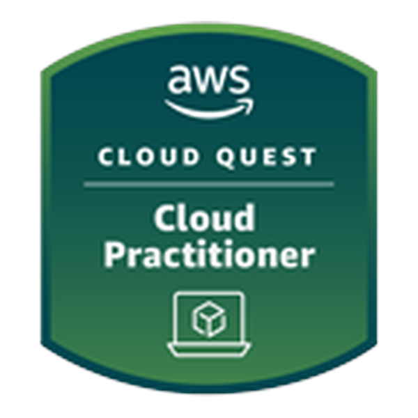
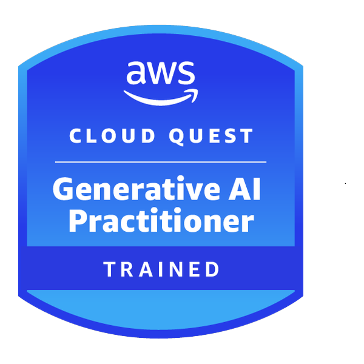
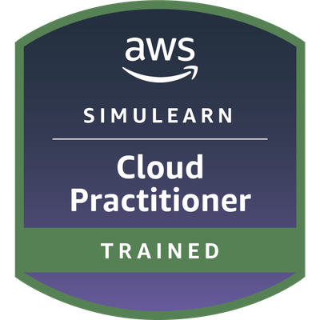

# Guia de insignias oficiales, microcredenciales y plataformas de aprendizaje

El ecosistema de formacion de Amazon Web Services cuenta con plataformas oficiales que permiten a los estudiantes adquirir experiencia practica y validar sus competencias mediante insignias digitales emitidas por plataformas de certificacion reconocidas en la industria como Credly.

---

## 1. Que es cada plataforma y como se diferencian

Para evitar confusiones habituales entre los estudiantes, es importante distinguir las vias principales de formacion de AWS:

| Criterio | AWS Skill Builder (Nivel Gratuito) | AWS Skill Builder (Suscripcion Individual / Pro) | AWS Educate |
|---|---|---|---|
| **Audiencia principal** | Profesionales, desarrolladores y personas preparando certificaciones (CLF, SAA). | Builders que buscan laboratorios avanzados, preparacion para examenes y roles especializados. | Estudiantes desde los 13 anos, principiantes absolutos y educadores. |
| **Requisito de tarjeta** | No requerida. | Requiere suscripcion mensual ($29 USD/mes) o activacion por becas/retos. | Ninguna. 100% libre de tarjeta bancaria. |
| **Metodologia** | Cursos oficiales, videos tecnicos, laboratorios guiados y simulador 3D (Cloud Practitioner). | Mas de 1,000 laboratorios con consola real, 7 roles de Cloud Quest y retos de certificacion (AWS Jam). | Rutas formativas cortas y modulares con consola de practica integrada (*sandbox* temporal). |
| **Tipo de acreditacion** | Insignias oficiales en Credly tras aprobar evaluaciones o Cloud Quest básico. | Insignias especializadas en Credly por cada rol avanzado de Cloud Quest y microcredenciales. | Insignias digitales de AWS Educate en Credly para cada modulo aprobado. |
| **Portal oficial** | [skillbuilder.aws](https://skillbuilder.aws/) | [skillbuilder.aws](https://skillbuilder.aws/) | [aws.amazon.com/education/awseducate](https://aws.amazon.com/education/awseducate/) |

---

## 2. Que es Credly y por que tiene valor profesional

**Credly** es la plataforma estandar global utilizada por corporaciones tecnologicas (incluidas AWS, IBM, Microsoft y Cisco) para emitir, gestionar y verificar credenciales digitales.

- **Verificacion criptografica:** Cada insignia cuenta con un enlace unico que permite a reclutadores y lideres tecnicos verificar que la emision provino directamente de Amazon Web Services, confirmando la fecha de expedicion y las habilidades evaluadas.
- **Integracion con LinkedIn:** Permite anadir las credenciales en la seccion oficial de "Licencias y certificaciones" con un solo clic.
- **Portabilidad:** Es independiente de tu institucion educativa o empleo actual; permanece asociada a tu correo personal para siempre.

---

## 3. Catalogo de insignias oficiales gratuitas del programa

A lo largo del curso **De cero a cloud**, los estudiantes tienen acceso a cuatro acreditaciones oficiales que no requieren costear examenes ni membresias de pago:

### 1. AWS Cloud Quest: Cloud Practitioner

- **Plataforma:** AWS Skill Builder.
- **Modalidad:** Videojuego de rol interactivo en 3D (*RPG*).
- **Enlace directo:** [Acceder a AWS Cloud Quest](https://skillbuilder.aws/learn/FU5WCYVGKY/aws-cloud-quest-cloud-practitioner/UBG3N32DBX)
- **Que valida:** Capacidad practica para crear y configurar buckets en Amazon S3, levantar servidores web en Amazon EC2, asignar Security Groups y diagnosticar problemas basicos de conectividad en bases de datos relacionales en una consola temporal de AWS.
- **Acreditacion:** Insignia digital oficial en Credly emitida por Amazon Web Services.

---

### 2. AWS Cloud Quest: Generative AI Practitioner

- **Plataforma:** AWS Skill Builder.
- **Modalidad:** Misiones complementarias en 3D enfocadas en inteligencia artificial.
- **Enlace directo:** [Acceder al catalogo de Cloud Quest](https://skillbuilder.aws/learn/FU5WCYVGKY/aws-cloud-quest-cloud-practitioner/UBG3N32DBX)
- **Que valida:** Comprension de modelos fundacionales (FMs), ingenieria de prompts y casos de uso empresariales de IA generativa sobre infraestructura de AWS.
- **Acreditacion:** Insignia digital oficial en Credly.

---

### 3. AWS SimuLearn: Cloud Practitioner

- **Plataforma:** AWS Skill Builder.
- **Idioma:** Espanol (Latinoamerica).
- **Modalidad:** Simulacion conversacional con clientes de negocio interactivos guiados por IA y laboratorios practicos en consola.
- **Enlace directo:** [Acceder a AWS SimuLearn en Espanol](https://skillbuilder.aws/learning-plan/EKHCUEWUUC/aws-simulearn-cloud-practitioner-espaol-latinoamrica/14SH7JS2DU)
- **Que valida:** Habilidades consultivas para traducir requerimientos de negocio a servicios adecuados de AWS, analizando costos, seguridad y escalabilidad.
- **Acreditacion:** Insignia digital oficial en Credly.

---

### 4. Insignias modulares en AWS Educate

AWS Educate ofrece rutas cortas autodidactas de entre 1 y 3 horas con evaluacion practica integrada:

- **Introduction to Cloud 101:** Fundamentos de computacion, almacenamiento, redes y gobernanza.
- **Getting Started with Storage:** Uso intensivo de Amazon S3, Amazon EBS y Amazon EFS.
- **Getting Started with Compute:** Instancias EC2, arquitecturas serverless con Lambda y contenedores.
- **Getting Started with Security:** Principios de IAM, menor privilegio y cifrado basico.
- **Enlace directo al catalogo:** [Explorar cursos en AWS Educate](https://aws.amazon.com/education/awseducate/)

---

## 4. Insignias avanzadas con AWS Skill Builder Pro

Si cuentas con una suscripcion individual a AWS Skill Builder (o la obtuviste a traves de becas como **AWS AI & ML Scholars** o retos comunitarios), se desbloquean los roles tecnicos avanzados de **AWS Cloud Quest**:

1. **Solutions Architect:** Diseno de arquitecturas de alta disponibilidad, balanceo de carga con ALB y bases de datos Multi-AZ.
2. **Serverless Developer:** Orquestacion de microservicios con AWS Step Functions, API Gateway, DynamoDB y Lambda.
3. **Security:** Implementacion perimetral con AWS WAF, gestion de incidentes con GuardDuty, cifrado con KMS y auditoria con Security Hub.
4. **Machine Learning:** Entrenamiento, ajuste y despliegue de modelos en produccion con Amazon SageMaker.
5. **Data Analytics:** Procesamiento de flujos de datos en tiempo real con Amazon Kinesis, consultas serverless con Amazon Athena y catalogacion con AWS Glue.
6. **Networking:** Conectividad hibrida, diseno de VPC complejas con Transit Gateway, Direct Connect y reglas avanzadas de enrutamiento.

Cada uno de estos roles otorga una **Insignia Digital Oficial individual en Credly** al completar el 100% de las misiones de la ciudad virtual.

---

## 5. Que son las microcredenciales oficiales de AWS

Las **Microcredenciales de AWS (*AWS Micro-credentials*)** representan un modelo contemporaneo de evaluacion practica enfocado en habilidades tecnicas especificas y acotadas, complementando a las certificaciones tradicionales de opcion multiple:

- **Enfoque basado en retos (*Performance-based assessment*):** A diferencia de un examen teorico, para obtener una microcredencial debes resolver un problema real dentro de una consola activa de AWS contra reloj y sin tutoriales guiados.
- **Evaluacion automatica de resultados:** Un motor de verificacion inspecciona la infraestructura desplegada en tu consola para confirmar que cumple exactamente con los criterios de seguridad, disponibilidad o rendimiento solicitados.
- **Emision en Credly:** Cada microcredencial aprobada emite una credencial oficial en Credly que certifica la competencia practica comprobable ante empleadores y clientes.
- **Ejemplos en Skill Builder:** Microcredenciales en observabilidad y monitoreo con CloudWatch, despliegue de infraestructura como codigo o mitigacion perimetral.

---

## 6. Paso a paso para vincular tus cuentas y reclamar tus badges

Para asegurar que tus insignias se registren correctamente en tu perfil publico de Credly:

1. **Crear tu perfil en Credly:**
   Registrate en [credly.com](https://www.credly.com/) utilizando la misma direccion de correo electronico con la que inicias sesion en AWS Skill Builder o AWS Educate. Si utilizas correos distintos, puedes anadir un correo secundario en la configuracion de cuenta de Credly.
2. **Autorizar el intercambio de datos en Skill Builder:**
   Inicia sesion en [skillbuilder.aws](https://skillbuilder.aws/), dirijete a tu perfil de usuario y en la seccion de preferencias de datos personales, marca la opcion para autorizar el envio de reconocimientos a plataformas de credenciales externas.
3. **Completar todas las misiones o examenes del modulo:**
   Asegurate de que la plataforma marque el progreso en 100% y confirma la generacion del certificado de finalizacion interno.
4. **Aceptar la emision en Credly:**
   En un plazo habitual de 24 a 48 horas recibiras un correo electronico con el asunto de invitacion de Credly. Haz clic en "Accept your badge" y configura la visibilidad de la insignia como **Publica**.
5. **Compartir en redes profesionales:**
   Enlaza tu credencial a tu perfil de LinkedIn y comparter el logro con tus companeros del **AWS User Group Playa Vicente** bajo el hashtag `#DeCeroACloud`.
